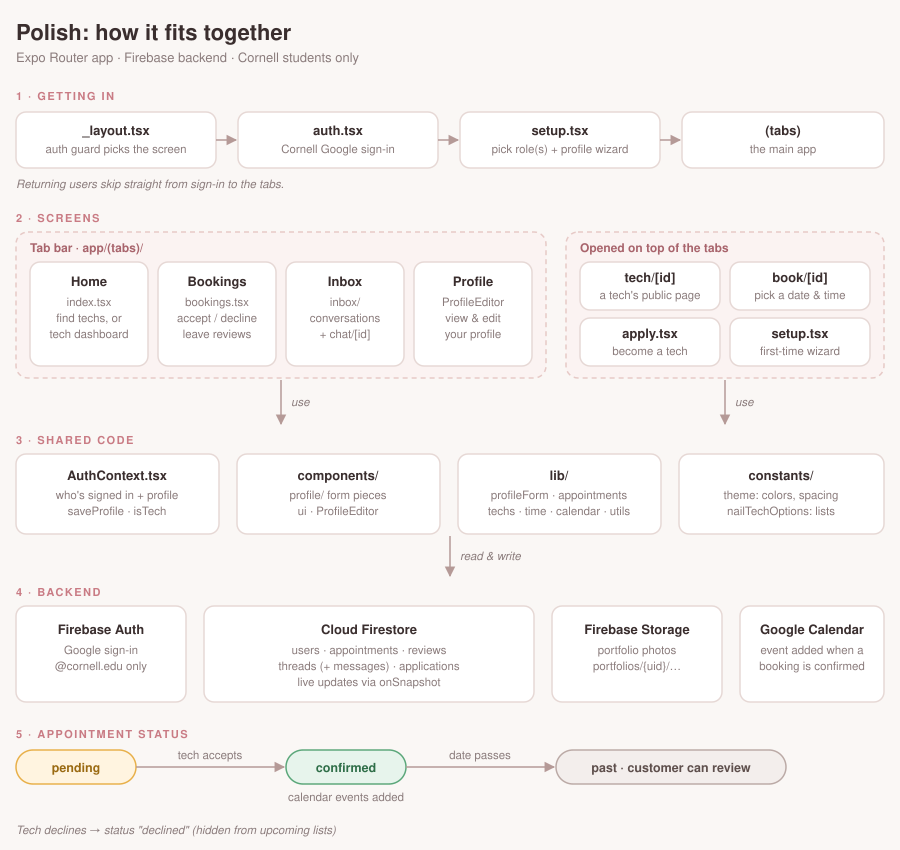

# Polish: Codebase Guide

Polish connects Cornell nail techs with students who want their nails done. Customers browse techs and book 30-minute slots. Techs set their hours and prices, then accept or decline requests. Both sides can chat, and confirmed bookings go on Google Calendar.

---

## Running it

1. Put `.env.local` (7 `EXPO_PUBLIC_*` keys) and `GoogleService-Info.plist` in the repo root. Both are git-ignored.
2. `npm install`
3. `npm run ios`. Google sign-in needs a development build, so Expo Go won't work. If you've pulled changes to `app.json` or packages, run `npx expo prebuild --clean` first.

`npm start` starts Metro only. `npx expo start --web` runs in the browser, but Google sign-in may not work there.

---

## Where things live

| Path | What it does |
|---|---|
| `app/` | Every file is a screen (Expo Router). `[id]` = URL parameter, `(tabs)` = tab bar group. |
| `app/_layout.tsx` | Auth guard: no user → `/auth`, unfinished profile → `/setup`, otherwise → tabs. |
| `contexts/AuthContext.tsx` | `useAuth()` → `user`, `userProfile`, `isTech`, `isCustomer`, `saveProfile`, `refreshProfile`. Also the main types. |
| `components/ProfileEditor.tsx` | The Profile tab: view mode, plus edit mode with collapsible sections. |
| `components/ui.tsx` | Shared building blocks: `Button`, `Chip`, `BackHeader`, `CenterMessage`, `Stars`, and common styles (`ui.card`, `ui.input`…). Use these before writing new styles. |
| `components/profile/` | Form pieces (hours, portfolio, pricing, location…) shared by setup and the Profile tab. |
| `lib/profileForm.ts` | The profile form's fields, required-field rules, and conversion to and from a saved profile. |
| `lib/appointments.ts` | Live appointment lists with the other person's name filled in. |
| `lib/techs.ts` | Loading a tech and reading their pricing tiers. |
| `lib/time.ts` | `"HH:MM"` helpers, 30-minute slots, schedule summaries. |
| `lib/` (other) | `utils` (names, dates, chat thread IDs), `googleCalendar`, `portfolio` (photo upload). |
| `constants/theme.ts` | Colors, spacing, type. Use these instead of hard-coded values. |
| `constants/nailTechOptions.ts` | Every option list (locations, tools, designs, payment methods, tiers). |

`@/` means the repo root, so `@/lib/utils` is `lib/utils.ts`.

---

## Key ideas

- **Roles.** `users/{uid}.roles` holds `"user"` (customer), `"nailTech"`, or both. Screens change based on this. Tech-only users get a dashboard on Home instead of the tech list.
- **Save profiles with `saveProfile`.** `AuthContext` reads `users/{uid}` at sign-in, without a live listener. `saveProfile` writes and updates the app in one step, and fields set to `undefined` are removed. If something else writes to the doc, call `refreshProfile()`.
- **Lists are live.** Appointments, techs, threads and messages use `onSnapshot`, and each effect returns its unsubscribe function.
- **Availability → slots.** A tech's schedule is `{ Monday: [{ start: "14:00", end: "18:00" }] }`. The booking screen cuts each block into 30-minute slots.
- **Chat thread IDs** are the two user IDs sorted and joined with `_`, so both people always open the same thread.
- **New users pick their role in `/setup`**, not on the sign-in screen.
- **Calendar runs on the phone.** Tokens are saved at sign-in. Each person's app adds the event to their own calendar: the tech's when they accept, the customer's the next time their Bookings tab loads.

---

## Data (Firestore)

| Collection | Main fields |
|---|---|
| `users/{uid}` | `roles`, `firstName`, `lastName`, `location`, `profileCompleted`, `googleCalendar`, `nailTechProfile` { bio, tools, designs, portfolio, availabilities.schedule, pricing, removalAddOn, paymentMethods, maxAppointmentsPerWeek, policies } |
| `appointments/{id}` | `clientId`, `techId`, `dateTime`, `status` (pending / confirmed / declined), `appointmentType`, `pricingTier`, `addOns`, `note`, `altTimeRequest`, calendar event IDs |
| `reviews/{id}` | `techId`, `clientId`, `appointmentId`, `rating` 1–5, `comment` |
| `threads/{a_b}` + `/messages` | `participantIds`, `lastMessage`, `lastMessageAt` · messages: `text`, `senderId`, `createdAt` |
| `applications/{uid}` | `uid`, bio, location, tools, designs, `whyApply`, `status` |

Portfolio photos go in Storage at `portfolios/{uid}/…`. The first photo is the cover.

---

## Known gaps

- **Double-booking is possible.** Slots don't check existing appointments.
- Customers can't cancel. Declining doesn't remove calendar events.
- Anyone can pick "Nail Tech" at sign-up, so `/apply` can be skipped. Nothing in the app approves applications.
- Slots are 30 minutes, but calendar events are 90.

---

## How do I…

- **Add a screen:** create `app/name.tsx` and go to it with `router.push('/name')`.
- **Add an option** (location, tool, payment…): edit `constants/nailTechOptions.ts`.
- **Add a tech profile field:** add it to `NailTechProfile` (`AuthContext.tsx`) and to `ProfileForm`, `formFromProfile` and `profileFromForm` (`lib/profileForm.ts`). Add an input in `components/profile/`, place it in `setup.tsx` and `ProfileEditor.tsx`, and show it in `tech/[id].tsx`.
- **Test with a non-Cornell account:** add the email to `DEMO_EMAILS` in `app/auth.tsx`.
- **Make someone a tech by hand:** in the Firebase console, add `"nailTech"` to their `roles`.
